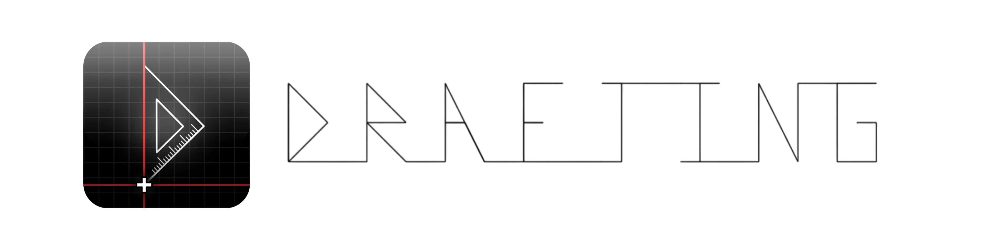
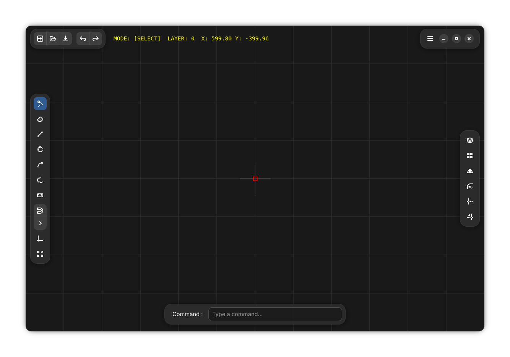

# Drafting

A simple 2D CAD application for Linux, built with GTK4 and libadwaita. A Windows developer preview is also available.



## Features

- Draw lines, circles, 3-point arcs, polylines and linear dimensions
- Object snap: endpoint, midpoint, center, quadrant and intersection, each toggleable from the snap settings dock
- Grid snapping with adaptive LOD grid (snaps to every minor grid step)
- Ortho mode (`F8` or the Ortho button): lock lines, polylines, dimensions and the mirror axis to horizontal or vertical; object snap overrides it
- Offset (line, circle, arc, polyline) with preview
- Mirror the selected objects across a line, with a live preview and a flip animation; keeps the originals, `Shift` deletes them. With more than 3000 objects selected the preview and animation show only the bounding box
- Trim and Extend (line, arc, circle, polyline) with live preview; hold `Shift` to swap between the two
- Hatch: click inside a closed area and the boundary is found for you (circles inside are left out); lines, cross or solid, with angle and spacing
- Text: click a point and type in a box (several lines, height, rotation); double-click a text or a hatch to edit it
- Delete the selected objects (`Delete` key or `del` command)
- Layers: show/hide, lock and pick the current layer from the Layers panel (right dock, or the `la` command); new objects go on the current layer and are drawn in the layer's color
- Multi-tab support, with an unsaved-changes prompt before closing
- Open, Save and Save As for DXF files (the file path is remembered per tab); large files open in the background
- Layouts: sheets with several viewports, each with its own scale (1:50, 1:100, ...), saved in the DXF and printed as one page
- Copy, cut and paste between drawings
- Autosave: unsaved drawings are backed up every 2 minutes and offered back after a crash
- Print (`Ctrl+P`): A0 to A4 or Letter, landscape or portrait, the current view or everything, fit to page or a fixed scale (1:1 to 1:500); choose a printer or save a PDF
- Rectangular array with preview
- Multi-select with window/crossing selection (AutoCAD-style)
- Move tool with snap
- Undo / Redo
- Command bar interface
- AutoCAD-style crosshair: a short red cross (size set with `cursorsize`) with a pick box when selecting
- Auto-pan at window edges
- Pan with the middle mouse button, `Space` + drag, or a two-finger scroll on a touchpad; zoom with the wheel, `Ctrl` + scroll or a pinch
- Wide zoom range (units are mm); the zoom-in limit shrinks for very large drawings so Cairo stays accurate
- Zoom to fit ignores a few far-away stray objects so the real drawing fills the view; `ze` zooms to everything
- Text and MText display (read, move, copy and save)
- Open DXF and DWG files (DWG is read-only; Save writes DXF)
- Block inserts and dimensions from other CAD programs
- Line weight and linetype, shown as stored in the file and editable per layer and per object

## DXF Support

DXF and DWG files are read, and DXF files are written, with [acadrust](https://crates.io/crates/acadrust) (newer DXF versions supported).

| Entity | Open | Save |
|---|---|---|
| Line | Yes | Yes |
| Circle | Yes | Yes |
| Arc | Yes | Yes |
| LWPolyline | Yes (segments with a bulge are converted to arcs) | Yes |
| Spline | Yes (flattened to a polyline) | Saved as a polyline |
| Ellipse | Yes (flattened to a polyline) | Saved as a polyline |
| Linear dimension (drawn in Drafting) | - | Saved as three plain lines |
| Layers | Yes (true color, on/off, lock, line weight, linetype) | Yes |
| Entity color | ACI and true color | Yes |
| Line weight / linetype | Yes (per layer and per object, ByLayer / ByBlock, LTSCALE) | Yes |
| Solid / Hatch | Yes (as filled areas) | SOLID or HATCH |
| Line-pattern hatch (made in Drafting) | - | Saved as separate lines |
| Text / MText | Yes (plain text only; formatting is dropped) | Saved as TEXT, or MTEXT when multi-line |
| Block insert (INSERT) | Yes (exploded into plain objects) | Saved as plain objects |
| Dimension (any type) | Yes (drawn from the stored geometry, as plain lines and text) | - |

Other entity types (tables, leaders, images, ...) are skipped when opening a file.

## Installation

### Linux (Flatpak) — Recommended

```sh
flatpak install com.pungpondsalami.drafting
```

> Flatpak is the primary supported platform.

### Windows (MSIX) — Developer Preview

Windows builds are published as MSIX packages on the [Releases page](https://github.com/pungpondsalami/Drafting/releases).

Download these four files into the same folder (check them against `SHA256SUMS.txt` if you like):

```
drafting.msix
drafting-cert.cer
install.bat
install.ps1
```

Double-click `install.bat` (it asks for administrator rights). The script trusts the certificate and installs the package.

The certificate is the same for every build, so after the first install you can simply double-click a newer `drafting.msix` to update.

> **Browser or SmartScreen warning?** The package is signed with a self-signed certificate, so Chrome or Windows SmartScreen may warn about the download. That is expected for an unsigned-by-a-public-CA developer preview. Verify the SHA-256 in `SHA256SUMS.txt` and keep the file; please don't turn off browser protection globally.

If you prefer to do it manually, from an Administrator PowerShell:

```powershell
Import-Certificate -FilePath .\drafting-cert.cer -CertStoreLocation Cert:\LocalMachine\TrustedPeople
Add-AppxPackage .\drafting.msix
```

See the [installation guide](docs/Steps_for_installing_Drafting_on_the_Windows_developer_version.pdf) for more details.

## Building from Source

### Requirements

- Rust (stable)
- GTK4 ≥ 4.20
- libadwaita ≥ 1.6
- Meson + Ninja

### Build

```sh
meson setup build
ninja -C build
ninja -C build install
```

Or for development:

```sh
cargo build
cargo run
```

## Keyboard Shortcuts

| Key | Action |
|---|---|
| `L` | Line tool |
| `C` | Circle tool |
| `A` | 3-point arc tool |
| `P` | Polyline tool |
| `D` | Dimension tool |
| `O` | Offset tool |
| `T` | Trim tool (`Shift`: extend) |
| `E` | Extend tool (`Shift`: trim) |
| `H` | Hatch tool |
| `X` | Text tool |
| `Delete` | Delete the selected objects |
| `S` | Select mode |
| `Z` | Zoom to cursor |
| `Ctrl` + `F` | Zoom to fit |
| `F8` | Toggle Ortho |
| `F9` | Toggle Snap |
| `Ctrl` + `P` | Print |
| `Ctrl` + `C` / `X` / `V` | Copy / Cut / Paste (`Ctrl` + `Shift` + `V` pastes in place) |

## Command Bar

Type commands in the command bar at the bottom:

| Command | Action |
|---|---|
| `l`, `line` | Line tool |
| `c`, `circle` | Circle tool |
| `a`, `arc` | 3-point arc tool |
| `pl`, `pline`, `polyline` | Polyline tool |
| `of`, `offset`, `of [dist]` | Offset tool |
| `tr`, `trim` | Trim tool |
| `ex`, `extend` | Extend tool |
| `mi`, `mirror` | Mirror the selected objects (select first) |
| `h`, `hatch` | Hatch tool |
| `tx`, `text` | Text tool |
| `del`, `delete`, `erase` | Delete the selected objects |
| `la`, `layer`, `layers` | Show or hide the Layers panel |
| `ar`, `array` | Rectangular array |
| `ortho`, `or` | Toggle Ortho |
| `cursorsize [1-100]` | Crosshair size in % of the view (100 = full screen) |
| `fit` | Zoom to fit (ignores far-away strays) |
| `ze`, `extents` | Zoom to every object |
| `z` | Zoom in at cursor |
| `u`, `undo` | Undo |
| `r`, `redo` | Redo |
| `o`, `open` | Open a DXF or DWG file |
| `save` | Save |
| `saveas` | Save As |
| `print`, `plot` | Print |
| `layout`, `lay` | Open or create layouts for the current drawing |
| `copy`, `cut`, `paste` | Copy, cut and paste objects |

## Layouts and viewports

A **Layout** is a sheet of paper that looks into your drawing through one or more **viewports**, each at its own scale. Layouts are saved in the DXF file (as real paper-space layouts with viewports) and open again as tabs next to the drawing.

- Type `layout` (or `lay`) to open the drawing's layouts that are not open, or to make a new one when they all are. **New Layout** and **Delete Layout** are also in the layout's toolbar. A new layout is A3 landscape; change it with the Paper and Orientation boxes.
- **New Viewport**, then drag a rectangle on the sheet. The viewport shows what the drawing tab is showing right now, at the nearest standard scale that fits it. So the quick way to place an area is: zoom the drawing tab to the part you want, switch to the layout, and drag the frame.
- Click a viewport to select it. Drag it to move it; drag its bottom-right square to resize it (the contents stay where they are on the sheet).
- **Scale** sets 1:1 up to 1:1000, or 10:1 to 2:1 for enlarged details. **From Drawing View** refills the selected viewport from the drawing tab's current view.
- **Edit Inside** lets you drag inside a viewport to pan the drawing, and scroll to step the scale. With it off, scroll zooms the sheet and the middle button pans the sheet. **Fit** shows the whole sheet.
- `Delete` removes the selected viewport, `Esc` cancels or deselects.
- **Print…** (or `Ctrl+P`) prints the sheet at its real size; the **Lines** box chooses layer colours or all black.
- `Ctrl+V` in a layout pastes what you copied from the drawing onto the sheet, centred at the pointer, at 1:1 (1 mm in the drawing = 1 mm on paper). Use it for title blocks, notes and frames. Click a pasted group to select it, drag to move it, drag the square at its bottom-right corner to scale it (or use **Scale Objects…** to type a factor), `Delete` removes it. `Ctrl+C` on a selected group or viewport copies it; pasting a viewport makes another one. Things on the sheet are saved in the DXF too, but come back as separate objects (not groups).

Viewports follow the drawing live, so edits show up right away. Only plan-view viewports are read from DXF files made elsewhere; other paper-space content (title blocks, text on the sheet) is not kept.

## Copy and paste

`Ctrl+C` copies the selected objects, `Ctrl+X` cuts them, and `Ctrl+V` pastes them with their centre at the mouse pointer. `Ctrl+Shift+V` pastes at the original position. The pasted objects stay selected, so you can move them straight away. Copying works between tabs; a layer the other drawing doesn't have is created. The commands are `copy`, `cut` and `paste`. The copy lives inside Drafting only (not the system clipboard).

## Autosave and recovery

Every 2 minutes Drafting writes a backup of each tab that has unsaved changes. Your real file is never touched by the backup; it is only replaced when you save. The backup is deleted when you save or discard the tab. If Drafting closed unexpectedly, the next start asks whether to recover the backed-up drawings; recovered tabs keep their name and file path and count as unsaved.

Backups are kept in `~/.local/share/drafting/autosave` (inside the Flatpak: `~/.var/app/com.pungpondsalami.drafting/data/drafting/autosave`). Objects of types Drafting can't open are not in the backup, the same as when saving.

## Print

`Ctrl+P` (or `print`) opens the print settings:

- **Paper**: A4, A3, A2, A1, A0 or Letter, landscape or portrait, with a 10 mm margin.
- **Area**: what you see now, or everything.
- **Scale**: fit to the page, or 1:1 up to 1:500 centred on the area (drawings are in mm).
- **Lines**: black, or the layer colours (white becomes black).

The next window picks the printer, or "Print to File" for a PDF. Line weights print at their real size (0.25 mm = 0.25 mm). Selection highlights are never printed.

## Trim and Extend

- **Trim**: click the part of an object to remove. Every other object acts as a cutting edge. A circle needs two cutting edges.
- **Extend**: click near the end of a line, arc or polyline to extend it to the nearest boundary.
- Objects that only touch at an endpoint do not count as crossing.

## Mirror

Select objects, then start Mirror (`mi` or the Mirror button). Click two points for the mirror line. The originals are kept; hold `Shift` on the second click to delete them. Text is moved to its mirrored position but its letters are not flipped (like AutoCAD with `MIRRTEXT` = 0). Ortho and object snap work for the axis points.

## Hatch

Pick Hatch (`H`, `hatch` or the button in the right dock), choose Lines, Cross or Solid with the angle and spacing in the panel, then click inside a closed area. Drafting finds the boundary from the lines, circles, arcs and polylines around the click (hidden layers are ignored) and fills it. Stay in the tool to hatch more areas; `Esc` leaves it.

- Circles and closed polylines inside the area are left unhatched as islands. Islands made of separate lines are only found when they lie to the right of the click on the same row.
- A hatch is its own object: if you move or trim the boundary afterwards, the hatch stays where it was.
- Double-click a hatch (in Select mode) to change its pattern, angle or spacing. Mirror turns the pattern angle too.
- Lines closer than 3 px on screen are drawn as a solid area.
- DXF: a hatch is saved as separate lines, so after reopening the file it is just lines. A hatch that comes from a DXF file is still opened as a plain outline or solid area.

## Text

Pick Text (`X`, `tx` or the button in the right dock), click where the text goes and type in the box: several lines, height and rotation in degrees. Single-line text sits on its baseline at the click, multi-line text hangs from its top-left corner. The height starts at about 16 px on screen and then remembers the last one you used. Double-click a text (in Select mode) to edit it.

## Layers

Open the panel with the layers button in the right dock (or type `la`).

- **Eye**: show or hide a layer. Hidden layers can't be picked or selected, and they are ignored by object snap and by Trim/Extend.
- **Lock**: locked layers stay visible and snappable (and still act as cutting edges), but their objects can't be selected or edited. The lock state is saved to DXF.
- **Click a name** to make it the current layer. New objects are created on it.
- Layers, their colors and per-object colors are read from DXF files and written back when you save.
- Right-click a layer name to rename or delete it (its objects move to layer 0). Layer add/rename/colour/delete can be undone with Ctrl+Z.
- Under the list, pick the line weight and linetype of the current layer.
- The **Selected objects** row sets them for the selected objects. `ByLayer` means follow the layer.
- Line weight is drawn as a fixed number of pixels (0.25 mm = 2 px) and does not grow with zoom. Patterns that get too fine to see are drawn solid.

## Limitations

- MText formatting (bold, italic, colors, mixed sizes) is dropped; only plain text is kept.
- Block inserts are exploded when a file is opened, so they are saved as plain objects.
- Dimensions from a file are plain lines and text, not editable dimensions.
- Block attributes (ATTRIB) are not shown.
- DWG files can be opened but not saved; use Save As to write a DXF.
- Linetypes that contain text or shapes are drawn as plain dashes.
- Undo keeps at most 100 steps and about one million objects in total, so very large drawings can be undone fewer times.
- Autosave backs up on a timer (2 minutes), so up to 2 minutes of work can still be lost; saving is still the safe way.

## License

GPL-3.0-or-later © 2026 Supakit Suptorranee
