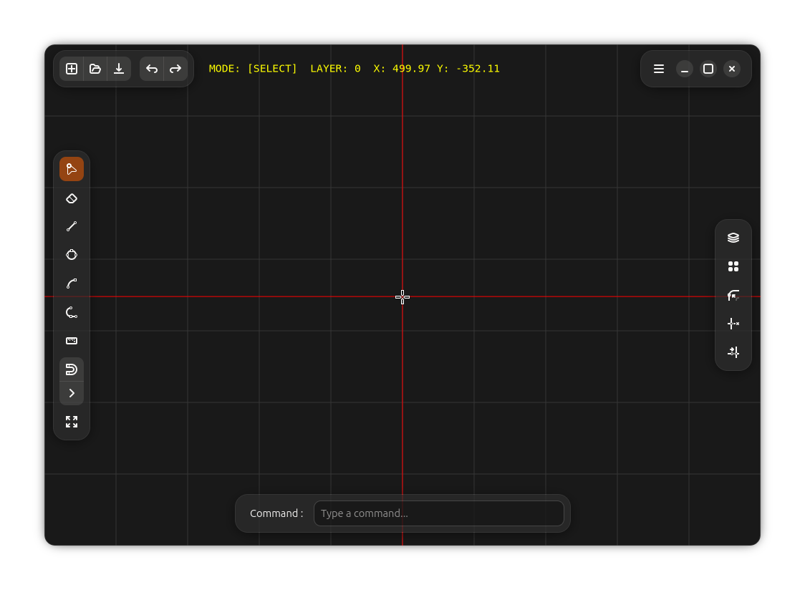

# Drafting

A simple 2D CAD application for Linux, built with GTK4 and libadwaita. A Windows developer preview is also available.



## Features

- Draw lines, circles, 3-point arcs, polylines and linear dimensions
- Object snap: endpoint, midpoint, center, quadrant and intersection, each toggleable from the snap settings dock
- Grid snapping with adaptive LOD grid
- Offset (line, circle, arc, polyline) with preview
- Multi-tab support, with an unsaved-changes prompt before closing
- Open, Save and Save As for DXF files (the file path is remembered per tab)
- Rectangular array with preview
- Multi-select with window/crossing selection (AutoCAD-style)
- Move tool with snap
- Undo / Redo
- Command bar interface
- Auto-pan at window edges

## DXF Support

| Entity | Open | Save |
|---|---|---|
| Line | Yes | Yes |
| Circle | Yes | Yes |
| Arc | Yes | Yes |
| LWPolyline | Yes (bulge segments load as straight lines) | Yes |
| Linear dimension | No | Saved as three plain lines |

Other entity types are skipped when opening a file.

## Installation

### Linux (Flatpak) — Recommended

```sh
flatpak install com.pungpondsalami.drafting
```

> Flatpak is the primary supported platform.

### Windows (MSIX) — Developer Preview

Windows builds are available as MSIX packages via [GitHub Actions](https://github.com/pungpondsalami/Drafting/actions).

Since the package is self-signed, you'll need to install the certificate first.
See [installation guide](docs/Steps_for_installing_Drafting_on_the_Windows_developer_version.pdf) for step-by-step instructions.

In short, from an Administrator PowerShell:

```powershell
Import-Certificate -FilePath .\drafting-cert.cer -CertStoreLocation Cert:\LocalMachine\TrustedPeople
Add-AppxPackage .\drafting.msix
```

## Building from Source

### Requirements

- Rust (stable)
- GTK4 ≥ 4.12
- libadwaita ≥ 1.4
- Meson + Ninja

### Build

```sh
meson setup build
ninja -C build
ninja -C build install
```

Or for development:

```sh
cargo build
cargo run
```

## Keyboard Shortcuts

| Key | Action |
|---|---|
| `L` | Line tool |
| `C` | Circle tool |
| `A` | 3-point arc tool |
| `P` | Polyline tool |
| `D` | Dimension tool |
| `O` | Offset tool |
| `S` | Select mode |
| `Z` | Zoom to cursor |

## Command Bar

Type commands in the command bar at the bottom:

| Command | Action |
|---|---|
| `l`, `line` | Line tool |
| `c`, `circle` | Circle tool |
| `a`, `arc` | 3-point arc tool |
| `pl`, `pline`, `polyline` | Polyline tool |
| `of`, `offset`, `of [space]` | Offset tool |
| `ar`, `array` | Rectangular array |
| `fit` | Zoom to fit |
| `z` | Zoom in at cursor |
| `u`, `undo` | Undo |
| `r`, `redo` | Redo |
| `o`, `open` | Open a DXF file |
| `save` | Save |
| `saveas` | Save As |

## License

GPL-3.0-or-later © 2026 Supakit Suptorranee
